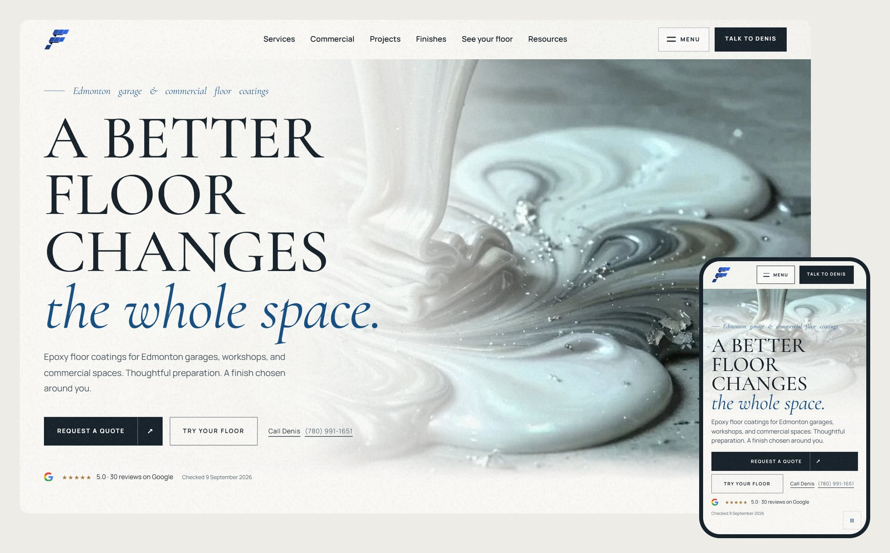
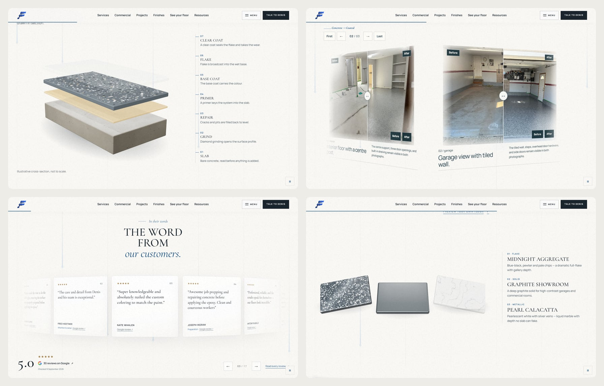
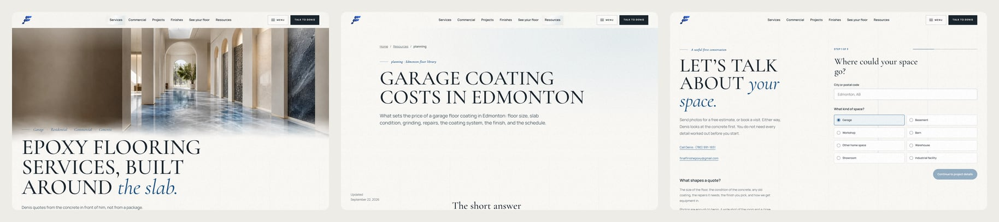
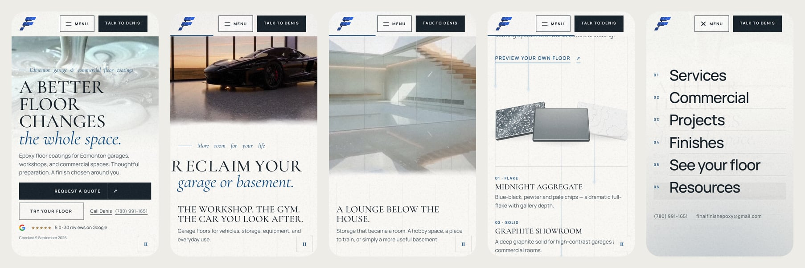

# How to use this repository

**This is the Final Finish Epoxy website.** It replaces the Squarespace site at finalfinishepoxy.ca. It is not live on that domain yet.

**Preview of this exact site:** https://lightgrey-wasp-945457.hostingersite.com (temporary Hostinger address)

If you are not technical, hand this README to a web developer. Putting the site live is a short job for any web developer and should not cost much.

### 1. Get the files

- **Easiest:** on GitHub, click **Code → Download ZIP** and unzip it.
  - The `deployed-site/` folder in the ZIP contains the finished website with real images, videos and 3D models. Nothing needs to be built to use it.
  - Some source images (`public/images/projects/generated/`, `assets/brand/source/`, `assets/source-project-photos/originals/`) are stored with Git LFS. Unless the repository setting *Include Git LFS objects in archives* is on, those files arrive in the ZIP as small text placeholders. This does not affect `deployed-site/`. It does matter if you want to rebuild from source.
- **For editing and rebuilding:** use git, which downloads the real LFS files:
  ```
  git lfs install
  git clone https://github.com/kr8tiv-io/final-finish-luminous-passage.git
  ```

### 2. Put the site online (no build)

Upload **everything inside `deployed-site/`**, including the hidden `.htaccess` files, to the host's web root (usually `public_html`). That folder is a file-for-file copy of the preview site above. Full steps, including pointing the domain, are in [MOVING-THE-SITE.md](MOVING-THE-SITE.md).

The `deployed-site/` copy is the preview build: it tells search engines not to index it, and its quote form shows a "please call" message. Before launching on the real domain, do a production build (step 5) instead.

### 3. Edit text and images

| What | Where |
|---|---|
| Pages (Home, About, Contact, Process, Warranty, Finishes, Service area, Projects) | `src/pages/*.astro` |
| Service pages | `src/pages/services/` |
| Resource / article pages (60 articles) | `src/content/resources/*.mdx` (plain text with a header block) |
| Homepage sections | `src/components/home/` |
| Reviews, project stories, before/after pairs, process steps | `src/data/` |
| Images, videos, 3D models, fonts, icons | `public/` (`public/images/`, `public/videos/`, `public/3d/`, `public/fonts/`) |

Files in `public/` are published as-is at the same path (`public/images/brand/x.jpg` appears at `/images/brand/x.jpg`). To replace an image, keep the same file name and size. After any edit, rebuild (step 5). Editing `deployed-site/` directly works for small text fixes but is overwritten by the next build.

### 4. Run it on your computer

Install Node.js 22 or newer (https://nodejs.org), then in the project folder:
```
npm install
npm run dev
```
Open the address it prints (usually http://localhost:4321).

### 5. Build and upload

Preview / static build (same as `deployed-site/`):
```
npm ci
PUBLIC_SITE_URL=https://your-preview-address npm run build:staging
npm run package:static-preview
```
Upload the contents of `dist/static-preview/`, hidden `.htaccess` files included. (The packager also zips the folder. On Linux, that needs the `zip` command. If it is missing, the folder is still complete.)

Production build for finalfinishepoxy.ca (indexable, working quote form; needs a host that runs Node.js):
```
PUBLIC_SITE_URL=https://www.finalfinishepoxy.ca npm run build:production
SITE_ENV=production PUBLIC_SITE_URL=https://www.finalfinishepoxy.ca npm start
```

### 6. The quote form

- **On a Node.js host (production build):** the form emails each quote request to `QUOTE_RECIPIENT`. Copy `.env.example` to `.env` and fill in `SMTP_HOST`, `SMTP_PORT`, `SMTP_SECURE`, `SMTP_USER`, `SMTP_PASSWORD`, `QUOTE_RECIPIENT` and `QUOTE_SENDER`. Hostinger email SMTP works. `RESEND_API_KEY` is an optional fallback.
- **On a static host (`deployed-site/` or `dist/static-preview/`):** there is no server, so the form does not send. It shows a message asking the visitor to call Denis at (780) 991-1651.

### 7. Moving to a new host and the domain

See [MOVING-THE-SITE.md](MOVING-THE-SITE.md).

---

<div align="center">



# Final Finish Epoxy — *Acts & Paper*

### A floor you can almost touch through the screen.

The rebuild of [finalfinishepoxy.ca](https://www.finalfinishepoxy.ca) for **Denis**, founder of Final Finish Epoxy Coatings in Edmonton, Alberta. Scroll-driven films held on paper, a 3D preparation stack and sample tablets, real before-and-afters, and 75 server-rendered pages written for people, for Google and for AI answer engines.
Designed and built by **[kr8tiv.io](https://kr8tiv.io)**.

> **The films set the mood. The HTML is the product.** Every word, FAQ and line of JSON-LD ships in the page. Turn the motion off and the site still reads, ranks and converts.

[](https://lightgrey-wasp-945457.hostingersite.com)
[](https://kr8tiv.io)
[](#tech-stack)
[](#the-concept--acts-and-paper)
[](#search-and-ai-search)
[](#run-it)

[The concept](#the-concept--acts-and-paper) · [Act by act](#the-homepage-act-by-act) · [Phones](#built-for-phones) · [Search & AI](#search-and-ai-search) · [Honest by construction](#honest-by-construction) · [Run it](#run-it) · [Deploy](#deploy)

</div>

---

## What this is

Final Finish Epoxy Coatings is Denis's floor-coating business in Edmonton: garages, basements, workshops, barns, kitchens and bathrooms, showrooms and warehouses, finished in flake, solid or metallic over properly prepared concrete. Google shows **5.0 from 30 reviews**. His current site is a Squarespace template.

This repository is its replacement. The brief was to look like a six-figure agency build while keeping the site bright, readable and fast on a phone; to keep the pour film that opens it; and to out-rank the Edmonton competition in Google and in AI answers without inventing a single claim.

---

## The concept — acts and paper

Two kinds of section alternate down the homepage.

| | |
|---|---|
| **Act** | A film or photograph held on a sticky stage while your scroll runs its story. It arrives under paper mist, the mist lifts, the film plays frame by frame with the scroll, a band of mist rises to carry the words, and the same mist closes over it at the end. |
| **Paper** | A white section on the page's grid: reading copy, the review ring, the before-and-after cylinder, the archive wall, the 3D pieces. |

Every act starts and ends in the same paper the next section is printed on, so there is no seam to find: no white line, no hard cut, no frame where a film shows up unwashed.

- **One controller.** `src/lib/motion/acts.ts` is the only writer of transforms; `src/styles/acts.css` owns composition. A second owner is how scroll sites start to shake, so there isn't one.
- **Films are scrubbed, never autoplayed.** Each one is revealed on its own poster frame and then glides to the frame your scroll asked for, so a film never double-exposes over its poster.
- **Films load on intent.** Nothing heavier than a poster downloads until the first scroll, and a phone gets its own 480p encodes.

---

## The homepage, act by act



| # | Section | What you see |
|---|---|---|
| 01 | **The pour** | A pearl-graded epoxy pour, scrubbed by your scroll. The headline's words converge; the Google rating sits under the calls to action with the date it was checked. |
| — | **In their words** | A ring of real Google review excerpts that turns as you scroll, each card linked to its review. |
| 03 | **Beneath the surface** | A slow walk up a pearl-toned stair, a magnifier over a flake floor, then a 3D cross-section of the system from bare slab to clear coat. |
| 04 | **Reclaim** | A car rolls into a glass garage while the headline's letters stream in behind it; then the basement slides in as a lounge. |
| 05 | **See the difference** | Real before-and-after pairs on a turning cylinder, a slider on the front card. Phones get a native swipe ribbon. |
| 06 | **The archive** | 96 project photographs on one wall, resolving from the cylinder's front card. |
| 07 | **Find your finish** | A resin reveal into the finish hall, then three 3D sample slabs (flake, solid, metallic) that fan out and tip toward you as a light swings across them. |
| 08 | **Commercial** | A showroom floor with a band of light travelling across it; downtime, operating conditions and scope. |
| — | **The sequence** | The six steps of the job on a horizontal track, then the planning questions people actually ask. |
| 10 | **Talk to Denis** | The last act ends on the words and the way in: a three-step quote request with photo upload on the contact page, or just call. |

The interior pages share the same system:



---

## Built for phones



- **Three tiers, one story.** `full` (desktop: films and WebGL), `balanced` (touch: films scrub, no WebGL canvas), `still` (reduced motion, Save-Data or 2G: the same narrative told without motion).
- **The pour holds the top of the screen**, and the words carry their own paper mist over it. No part of the headline sits below 3:1 contrast on an iPhone 15 Pro, a Pixel 7 or an iPhone SE.
- **The rooms are framed for the window you actually get.** On a phone each reclaim film is fitted to the space above its band of mist, so you see the car arrive and the floor it arrives on, not the sky.
- **The sample slabs are the desktop scene's own render**, cut into three tablets and fanned with CSS scroll-driven animation, so a phone gets the 3D look without a WebGL context.
- **Budgets are enforced.** Phone arrival stays under 0.8 MB; `budgets.json` is checked by `npm run check:budgets`.

---

## Search and AI search

- **75 indexable pages, all prerendered:** the homepage; garage floor coating in Edmonton, residential, commercial and concrete services; projects; finishes; the floor visualizer (30 inspiration finishes, your own photo); process; about; service area; warranty; contact; and a library of **60 guides**.
- **Answer-first guides.** Each one opens with the answer, cites its sources and ends with the questions people ask, rendered on the page and mirrored in `FAQPage` JSON-LD.
- **One business entity.** A single `HomeAndConstructionBusiness` node (`/#business`) that every `Service`, `Article` and FAQ points at, with `BreadcrumbList` on every page.
- **Built for answer engines.** `llms.txt` and `llms-full.txt` are generated from the built pages at build time.
- **Canonical by construction.** The sitemap exists in production only and lists canonical URLs only. Staging and previews are `noindex` and point their canonicals at www.finalfinishepoxy.ca, so a preview can never compete with the real site.
- **No rating gaming.** No self-serving `AggregateRating` markup; the rating on the page is a dated snapshot with a freshness check (`npm run check:reviews`).

---

## Honest by construction

- Every factual claim traces to Denis's own site, his Google listing, or Denis himself: [`docs/context/CLAIMS-LEDGER.md`](docs/context/CLAIMS-LEDGER.md).
- `scripts/validate-content.mjs` fails the build if a guide names a competitor or a town beyond Edmonton; states a price, years in business or a warranty length as fact; recommends a polyaspartic or polyurea install; or still says "draft" once published.
- Before-and-after pairs stay labelled pending until Denis approves each one: [`docs/approvals/2026-09-project-pairs.md`](docs/approvals/2026-09-project-pairs.md).
- The films are architectural concepts and say so; nothing is presented as a Final Finish installation unless it is one.

---

## Tech stack

| | |
|---|---|
| **Framework** | Astro 7 (server output, Node adapter) with React 19 islands and the Astro client router |
| **Motion** | GSAP 3.15 (ScrollTrigger, SplitText, Flip, DrawSVG) and Lenis |
| **3D** | three.js 0.182, React Three Fiber 9, drei |
| **Type** | Cormorant Garamond and Manrope, self-hosted and subset |
| **Palette** | paper `#faf9f6` · ink `#17222a` · cobalt `#164f83` · bronze `#a57d42` |
| **Content** | Astro content collections with zod schemas |
| **Media** | sharp, AVIF/WebP ladders, 480/720/1080 film encodes; originals in Git LFS |
| **Quote form** | `/api/quote` over Nodemailer (SMTP) or Resend |
| **Tests** | Vitest (417 unit tests), Playwright end-to-end, content validation |

```
src/
  pages/               75 routes, /api/quote
  components/home/     the homepage pieces: ReviewRing, PreparationLayers (3D), FinishSamples (3D), ArchiveLattice, ProcessTrack
  components/nav/      the full-screen menu (the header's own <nav>, moved and Flip-animated)
  lib/motion/          acts.ts (the one controller), route-lifecycle.ts, reveal.ts, the layout canvas
  styles/              design-system.css (type and tokens), acts.css (composition)
  content/resources/   the 60 guides
scripts/               build-with-env, build-llms, validate-content, package-static-preview, measure-delivery, check-budgets
deploy/static-preview/ .htaccess for the Hostinger preview
docs/context/          the plan, claims ledger, motion vocabulary, delivery budgets
docs/ci/               the parked CI workflow (see its header)
```

---

## Run it

```bash
git lfs install && git lfs pull   # films, posters and photographs live in Git LFS
npm ci
SITE_ENV=staging PUBLIC_SITE_URL=http://127.0.0.1:4333 npm run dev -- --host 127.0.0.1 --port 4333
```

```bash
npm run check          # astro check
npm test               # unit tests
npm run test:content   # content collection rules
npx playwright test    # end to end (set FFE_BASE_URL to test a built server)
```

---

## Deploy

**Production, on the real domain.** A Node server:

```bash
PUBLIC_SITE_URL=https://www.finalfinishepoxy.ca npm run build:production
SITE_ENV=production PUBLIC_SITE_URL=https://www.finalfinishepoxy.ca npm start
```

The quote form needs `QUOTE_RECIPIENT`, `QUOTE_SENDER`, and either `SMTP_HOST`, `SMTP_PORT`, `SMTP_SECURE`, `SMTP_USER` and `SMTP_PASSWORD`, or `RESEND_API_KEY`. The visualizer's automatic floor detection stays off unless it is enabled and `FAL_KEY` is set. The cutover also needs 301s for the old Squarespace URLs, Search Console, and the Google Business Profile's website link.

**Preview, on Hostinger shared hosting.** A static copy of the staging build:

```bash
PUBLIC_SITE_URL=https://<preview>.hostingersite.com npm run build:staging
npm run package:static-preview
```

Deploy the zip with the Hostinger MCP (`hosting_deployStaticWebsite`, which replaces the whole site), then clear the site's cache. A static preview has no `/api` routes, so its quote form shows the "call Denis" message instead of sending.

---

## Status

- **Preview:** live at [lightgrey-wasp-945457.hostingersite.com](https://lightgrey-wasp-945457.hostingersite.com) (September 2026, `noindex`).
- **Waiting on Denis:** approval of the before-and-after pairs; whether a primer coat belongs in the preparation diagram; access to his hosting and domain for the cutover.
- **CI:** [`docs/ci/quality.yml`](docs/ci/quality.yml) is parked; its header explains why and how to switch it on.
- **Known test debt:** two navigation end-to-end assertions predate the acts homepage (they expect a single canvas and the old journey director).

---

<div align="center">

**Final Finish Epoxy Coatings** · Edmonton, Alberta · (780) 991-1651 · finalfinishepoxy@gmail.com

Designed and built by **[kr8tiv.io](https://kr8tiv.io)**

</div>
