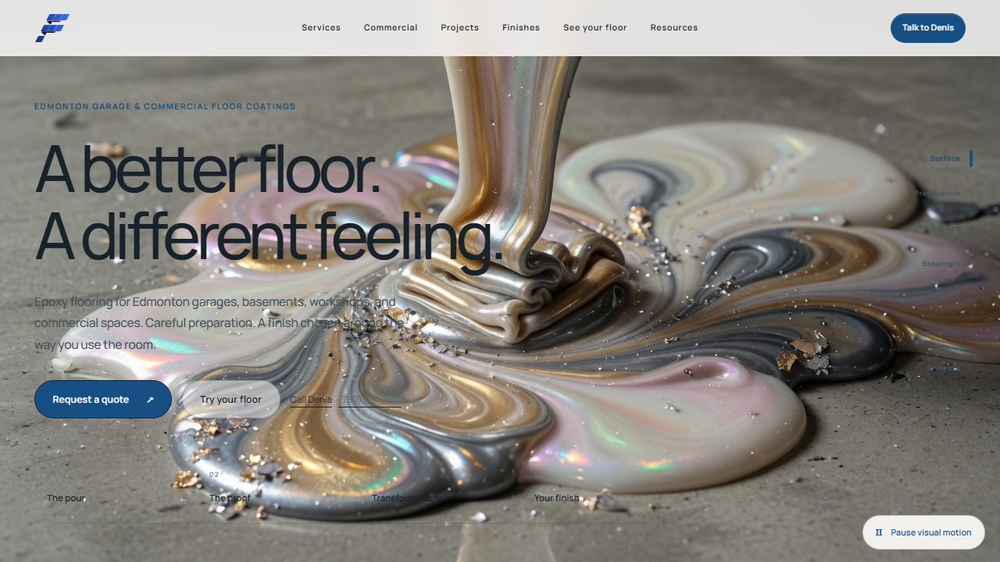
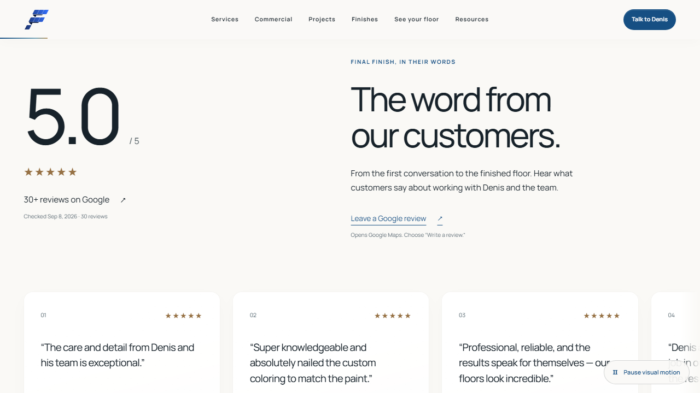
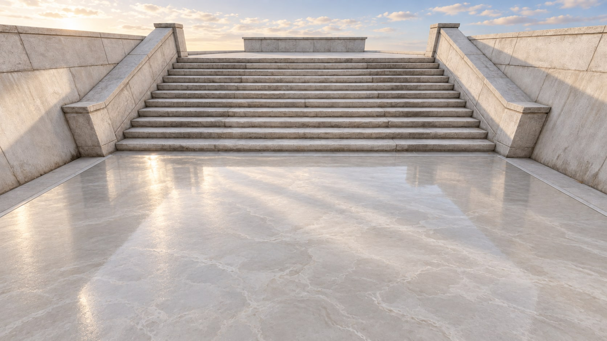

<p align="center">
  
</p>

<h1 align="center">Final Finish Epoxy · Follow the Floor</h1>

<p align="center">
  <strong>A little theatre. A very practical transformation.</strong><br />
  A material-led digital experience for an Edmonton flooring client—<br />
  from the first pour to a conversation about the customer's own space.
</p>

<p align="center">
  Astro · React · Three.js · GSAP · Blender<br />
  Warm white / architectural typography / real project evidence
</p>

## The idea

The floor is the thread. A flowing material becomes a finished room; a room becomes a possibility; a real project brings that possibility back to earth. Every invitation should lead somewhere useful: explore preparation, reclaim a garage or basement, choose a finish, or talk to Denis.

The opening is the **pouring epoxy film**, visible immediately and drawn forward by native scrolling. There is deliberately no artificial floor-colour selector over the film. Finish exploration belongs in the studio, where the visitor has a stable view and meaningful controls.

Manrope provides one precise typographic voice. Warm white gives the work space; charcoal keeps the reading clear; cobalt identifies actions. Architectural films are labelled concepts and kept distinct from the client's project photographs.

## In the browser



*Actual local browser capture. The pouring imagery is concept footage, not a photographed Final Finish installation.*

### Proof, then possibility

The pouring film now gives way to a generous white customer stage: **17 genuine, individually attributed Google excerpts**, equal-size cards, native horizontal exploration, and controls that stop for reading. The rating is dated evidence, not an invented live feed: Google showed **5.0 from 30 reviews** when checked on September 8, 2026 in Edmonton.

Three selected before/after pairs now form a horizontal project gallery. GSAP carries the gallery between projects; each photograph has its own independent, keyboard-accessible comparison divider. Original proportions and complete portrait frames are retained, with wide asymmetric edges dissolving into the paper background. Pairing selections are based on visible geometry and remain subject to Denis's confirmation. A separate preparation story keeps differently angled photographs side by side.

The shared navigation has a moving material inset, a fine reading-progress line and direct chapter links beneath the opening. Following the latest client direction, titles and subtitles sit directly on the imagery **without white shadows or backdrop panels**. Seventeen review cards now include editorial topic labels and discreet initials; a new HTML planning section answers useful questions about concrete condition, room use and quoting.



*Actual desktop browser capture; the phone layout and touch targets are also covered by browser emulation, not yet physical-device certification.*



*The new stair material study: luminous pearl-grey epoxy, pale architecture, and intentional daylight. This generated concept replaces the dark-speckled stair film with a still and a moving square detail lens; it is not client project evidence or a new video.*

Wider asymmetric transitions, a stable shader edge and locked media handoffs replace drifting visual noise. [The iteration notes](docs/follow-the-floor/PROOF-AND-MOTION-POLISH.md) record source evidence, image provenance and the limits of this implementation.

| Surface | What this implementation does |
| --- | --- |
| Opening and journey | Native-scroll director, decoded-frame readiness, aspect-correct film compositing, direct chapter links, and a persistent motion control. |
| Spatial study | A small Blender-authored threshold with an exported camera track. It did not meet the visual gate and is available only at `/?study=threshold#garage` in local development, not the default journey. |
| Private finish studio | Thirty stable inspiration IDs, perspective-correct floor projection, local photo normalization, manual corners, original/preview comparison, and local object erase/restore with undo. |
| Consultation | Three stages, selected-finish handoff, optional photographs with explicit attachment consent, and the chosen contact channel required. |
| Evidence | Seventeen genuine review excerpts immediately after the opening; three visually selected overlay comparisons and one separate preparation story, eight real photographs in total. Source and pending client confirmation are explicit. |
| Search foundation | Useful server-rendered headings, descriptions, links and business identity; staging indexing is disabled. Original evidence and editorial review remain essential. |

## Motion with one owner

```text
Native scroll → journey director → ready media + spatial camera
                         ↓
                 GSAP editorial reveals

Local interaction → React state → stable studio / quote controls
```

Three.js renders the imagery and spatial study; GSAP handles editorial choreography; Framer Motion is confined to local interface transitions. Reading and editing surfaces stay steady. The homepage has one demand-rendered WebGL canvas, with useful HTML and posters when enhancement is unavailable.

Current and adjacent media are staged rather than loading the whole film library on arrival. Local H.264 encodes use 24 fps, six-frame keyframe intervals, fast-start and no audio:

| Complete six-film variant set | Encoded media only |
| --- | --- |
| 480p | 5.28 MiB |
| 720p | 10.96 MiB |
| 1080p | 19.02 MiB; not the default |

These are file sizes, not measured route transfer or Core Web Vitals results. Device testing and field performance gates are still open.

## Status: first visual gate, not launch-ready

The original Grok checkout is preserved; implementation is isolated on `feature/follow-the-floor`. The [30-package implementation ledger](docs/follow-the-floor/IMPLEMENTATION.md) distinguishes working features from remaining work.

The important unfinished gates include production-quality material samples and architecture, the studio's opening room example, full cinematic route templates, the fifty-guide editorial review, physical Apple/Android checks, and production abuse protection. Browser emulation does not establish physical-device compatibility.

A new local Blender stair-ascent study also failed its visual-quality gate. No new stair film was published: the stronger pearl-grey still remains in place. Its reproducible study and future hold/walk/landing timing contract are documented in [the stair production notes](tools/blender/PEARL_STAIR_ASCENT.md).

The existing fifty guides currently carry production-emittable metadata. **That metadata is not proof of editorial approval.** This branch has not reverified every article or Denis's company-specific claims. Do not publish the redesign until the content gate is closed.

No live-domain cutover has occurred. A protected, temporary Hostinger environment is the intended staging destination, not a completed deployment.

## Run the isolated preview

Node.js 22.12 or newer is required. Use the appropriate existing environment configuration; do not commit credentials.

```powershell
$env:SITE_ENV = 'staging'
$env:PUBLIC_SITE_URL = 'http://127.0.0.1:4333'
npm run dev -- --host 127.0.0.1 --port 4333 --background
npm run dev -- status
```

Use `npm run dev -- logs` and `npm run dev -- stop` from this worktree only.

| Check | Command |
| --- | --- |
| Unit regressions | `npm test` |
| Astro / TypeScript | `npm run check` |
| Current first-gate browser suite | `npx playwright test --config=playwright.gate.config.ts` |
| Existing content checks | `npm run test:content` |
| Project asset checks | `npm run test:project-assets` |
| Legacy asset contract | `npm run validate:3d` |
| New threshold contract | `node --test tools/blender/tests/test_follow_floor_threshold.mjs` |
| Staging build | `npm run build:staging` |
| Recoverable working-tree copy | `node scripts/checkpoint-follow-floor.mjs` |

The first-gate browser suite uses the already-running local server and does not send real email or call an image provider. Its Chromium/WebKit phone profiles are emulations. The older full-site browser suite still needs reconciliation with the redesigned journey.

## Privacy and reliability

Photos remain local unless the visitor explicitly attaches them to a quote. The shared admission path checks encoded type, dimensions and size before bitmap allocation; normalized image geometry is shared by corners and projection. Animated images are rejected. Replacement invalidates prior photo work.

Automatic detection is **disabled** until provider terms, spending limits and production processing controls are approved. Manual preview is available without it.

Quote delivery has same-origin JSON validation, bounded payloads, explicit attachment handling and delivery deadlines. Network uncertainty is reported honestly rather than silently inviting a duplicate enquiry. Remaining release requirements include a shared abuse store, bot protection, trusted proxy configuration and isolated native image processing. This is not a completed penetration test.

## Assets and provenance

- Existing films and source photographs are preserved. Responsive film derivatives have their own hash manifest under `public/videos/follow-floor`.
- The new threshold's Blender builder, transaction tests and GLB contract live under `tools/blender`; runtime assets and their manifest are in `public/scenes/follow-floor-threshold`.
- Client project derivatives live under `public/images/projects/generated`; pairing records are separate from presentation.
- Concept architecture is not project evidence. Procedural finish previews are not verified supplier samples.
- GSAP uses its own commercial license; do not describe the entire dependency stack as MIT-licensed.

## The people behind the floor

**Final Finish Epoxy** · Denis · Edmonton, Alberta<br />
[(780) 991-1651](tel:+17809911651) · [finalfinishepoxy@gmail.com](mailto:finalfinishepoxy@gmail.com)

Design direction and implementation for the client by **[kr8tiv.io](https://kr8tiv.io)**.

<p align="center"><em>Follow the floor. Find what the room could become.</em></p>
