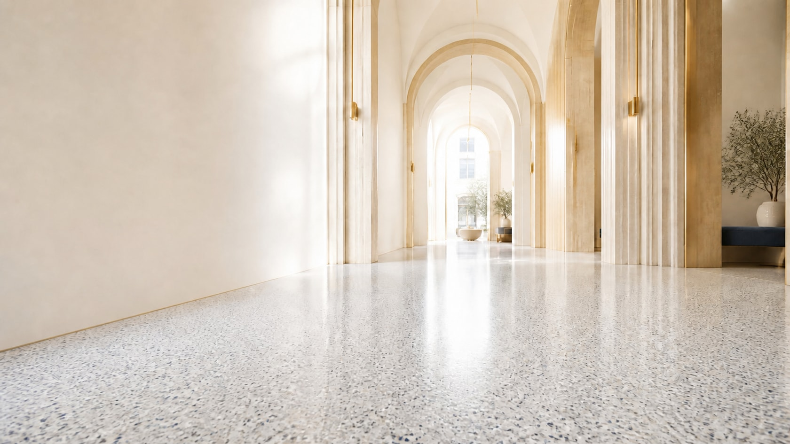
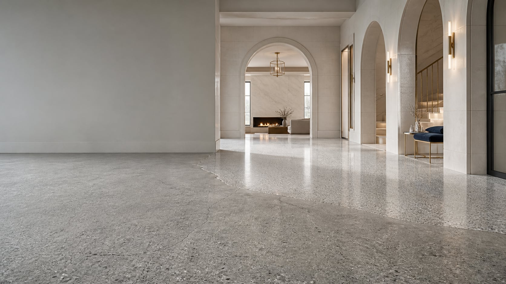
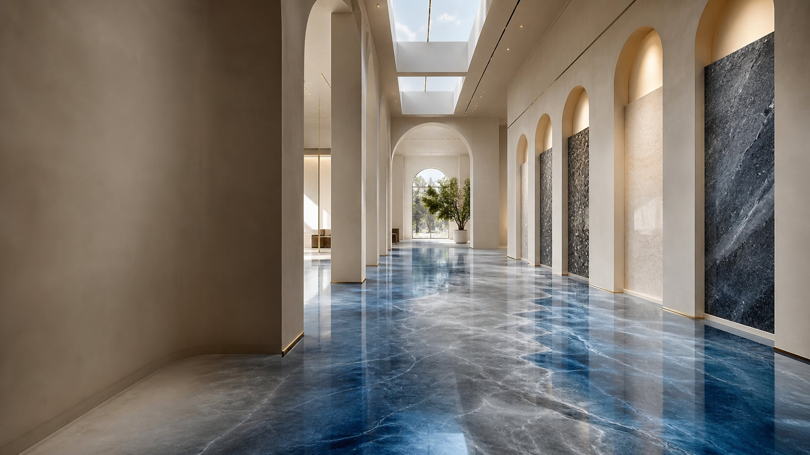
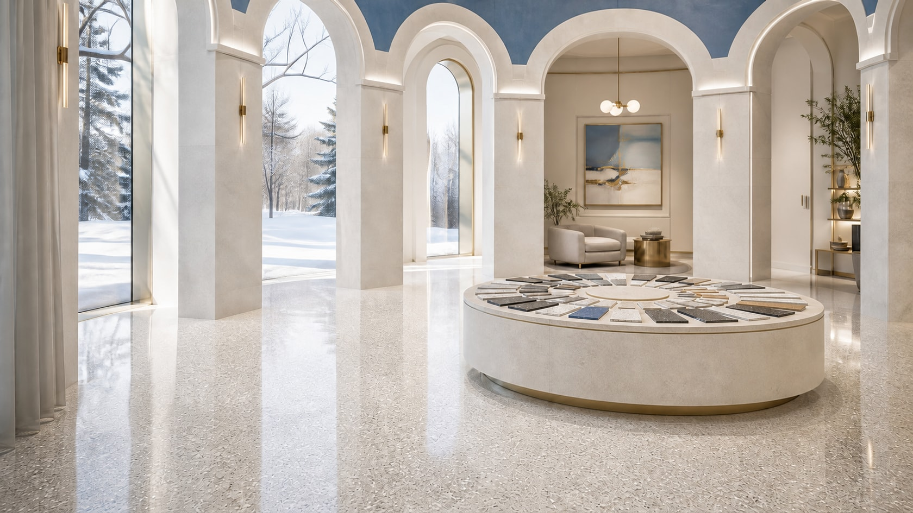

<p align="center">
  
</p>

<h1 align="center">Final Finish Epoxy</h1>

<p align="center">
  <strong>A luminous, scroll-driven 3D rebuild for Edmonton concrete coatings.</strong><br />
  Real project proof, a private-by-default 30-finish visualizer, and 50 sourced planning guides—inside one very bright building.
</p>

<p align="center">
  
  
  
  
  
</p>

---

This is not a theme with a spinning cube dropped on top. It is an intentionally layered experience: a fast, semantic Astro site paints the first frame; authored photography carries the realism; lightweight GSAP movement connects the rooms; and capability-gated Three.js geometry adds depth only when a visitor’s device can comfortably handle it.

The result should feel like walking from a sunlit portico into a sequence of contemporary halls—then arriving at something wonderfully practical: Denis’s work, the finish options, and a clear way to ask for a quote.

## The rooms

<table>
  <tr>
    <td width="33%"></td>
    <td width="33%"></td>
    <td width="33%"></td>
  </tr>
  <tr>
    <td><strong>01 · Foundation Chamber</strong><br />Preparation and system thinking before decoration.</td>
    <td><strong>02 · Luminous Finish Hall</strong><br />Flake, solid, metallic, and quartz inspiration.</td>
    <td><strong>03 · Consultation Court</strong><br />Thirty finishes, one room photo, and a direct path to Denis.</td>
  </tr>
</table>

The homepage follows five architectural chapters: Portico, Foundation Chamber, Luminous Finish Hall, Proof Arcade, and Consultation Court. Motion enhances this semantic structure; it never replaces it.

## What is inside

- **Adaptive 3D passage.** Six compressed GLB scenes and 45 authored textures load after the useful page. Reduced-motion, save-data, low-memory, mobile, and missing-WebGL paths receive a polished static experience.
- **Real project archive.** Ninety-six source photographs are preserved outside the public bundle with provenance. Six close-viewpoint candidates become accessible before/after comparisons with hover, drag, touch, and arrow-key control.
- **30-finish floor visualizer.** Manual perspective mapping stays entirely in the browser. Optional AI floor detection requires explicit consent before a photo leaves the device.
- **50-resource SEO library.** Long-form Edmonton floor-planning guides include inline primary-source citations, canonical URLs, related reading, `BlogPosting` schema, and a fail-closed editorial gate.
- **Quote journey.** A six-step lead form uses validation, rate limiting, a honeypot, escaped email output, Hostinger SMTP first, and Resend as an optional fallback.
- **Truthful search layer.** Organization and website schema, sitemap support, `robots.txt`, `llms.txt`, social metadata, and no fabricated ratings or warranty claims.

## A fast building, not a heavy demo reel

```text
HTML + critical imagery
        ↓
semantic chapters and conversion paths
        ↓ idle / capability check
GSAP + Lenis movement
        ↓ capable desktop only
progressive Three.js passage chunks
```

The high-priority first frame is a compressed AVIF/WebP/JPEG picture, not a WebGL render. Heavy scene code is dynamically imported. Project photography is lazy-loaded in AVIF and WebP with an optimized JPEG fallback. Every visual route remains useful without JavaScript.

## Local development

Node.js 22.12 or newer is required.

```bash
npm install
cp .env.example .env.local
npm run dev
```

Useful checks:

| Command | Purpose |
| --- | --- |
| `npm run check` | Astro and TypeScript diagnostics |
| `npm test` | Vitest unit suite |
| `npm run test:content` | Publishing and resource-library tests |
| `npm run test:project-assets` | Photo provenance and transaction tests |
| `npm run test:e2e` | Chromium and WebKit browser journeys |
| `npm run validate:3d` | Verify committed GLBs, textures, and manifest |
| `npm run assets:validate` | Verify project derivatives and archive boundaries |
| `npm run validate:content` | Enforce exactly 50 sourced guides at 900–1300 words |
| `npm run build` | Build only when `SITE_ENV` is explicitly `staging` or `production` |
| `npm run build:staging` | Cross-platform staging build; sets `SITE_ENV=staging` |
| `npm run build:production` | Cross-platform production build; sets `SITE_ENV=production` |

## Editorial and project-photo gates

All 50 resources currently remain `draft: true` with `reviewStatus: needs-review`. Staging renders them with `noindex`; production omits anything that is not both approved and non-draft. Denis should verify company-specific service, system, timing, warranty, credential, pricing, and performance language before changing either field.

The six project comparisons are also explicitly marked for pairing review. Their source photographs are authentic, but the “before” and “after” roles must be confirmed by Denis before the production-domain switch.

## Environment and deployment

Copy `.env.example` and configure only the services being used. Set `PUBLIC_SITE_URL` to the actual origin of that deployment, and set `SITE_ENV` to `staging` or `production`. `SITE_ENV` is required and is the single source of truth for draft visibility, page `noindex`, and crawler directives; `PUBLIC_SITE_URL` is the single URL source for the sitemap, canonical URLs, social URLs, and structured-data URLs. Important remaining values include Hostinger SMTP credentials, optional Resend credentials, and an optional FAL key for consented floor masking.

The production output uses Astro’s standalone Node adapter:

```text
Staging build:    npm run build:staging
Production build: npm run build:production
Output:        dist
Start file:    dist/server/entry.mjs
```

The intended staging target is a fresh Hostinger temporary subdomain. Set `PUBLIC_SITE_URL` to that exact HTTPS subdomain and run `npm run build:staging`; staging emits `noindex,nofollow,noarchive`, disallows crawling in `robots.txt`, and can show review-gated resources. For production, set `PUBLIC_SITE_URL=https://www.finalfinishepoxy.ca` and run `npm run build:production`; only non-draft resources with an approved or published status can be emitted. Do not use plain `npm run build` until both required values are set—the build fails closed when `SITE_ENV` is missing or invalid.

## Asset provenance

- Cinematic architectural plates were art-directed for this build and optimized locally.
- Blender source, export scripts, validation contracts, GLBs, and textures live in `tools/blender`, `assets/3d`, and `public/3d`.
- Client project originals live under `assets/source-project-photos/originals` in Git LFS and are never served directly.
- Runtime project derivatives live under `public/images/projects/generated`; their large binary history is stored in Git LFS so the repository itself stays responsive.
- The complete pairing and provenance record lives in `src/data/project-photo-pairs.json`.

## The humans

**Final Finish Epoxy**<br />
Denis · Edmonton, Alberta<br />
[(780) 991-1651](tel:+17809911651) · [finalfinishepoxy@gmail.com](mailto:finalfinishepoxy@gmail.com)

Concept, architecture, engineering, and launch system by **[kr8tiv.io](https://kr8tiv.io)**.

<p align="center"><em>Good concrete deserves a little theatre.</em></p>
