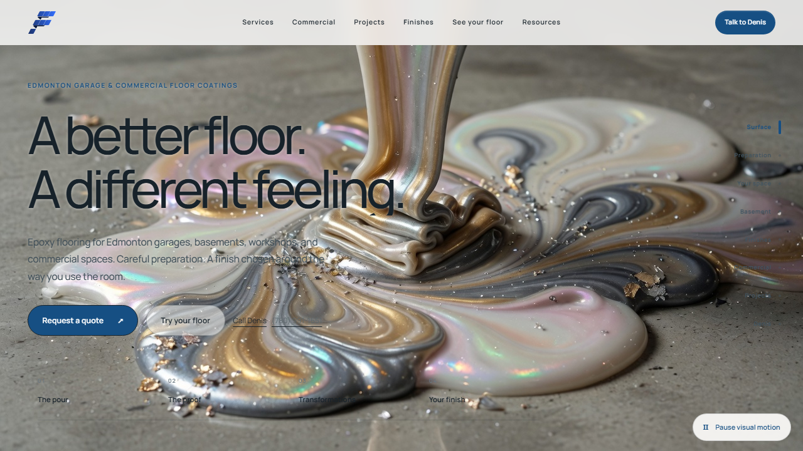
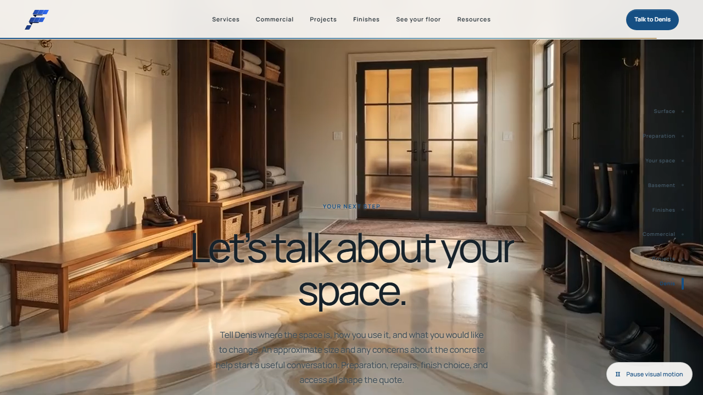

# Final Finish Epoxy — source and experience audit

14 September 2026 · Follow the Floor · Unreleased working version

## Executive assessment

The strongest direction is already present: a memorable scroll-driven pour, luminous architecture, restrained blue actions, early customer proof, and genuine project photography. Keep those assets and that identity. The next improvement should be **one coherent visual and interaction system**, not another collection of effects.

The latest verified local implementation is `.worktrees/follow-the-floor`. It contains substantially newer uncommitted work than GitHub main. This audit reviews that working tree, including staged, unstaged and relevant untracked files. It does not certify every file or every device, and it does not change the website design.

Two desktop gallery checks fail repeatedly. Text over the pour and consultation film is visibly hard to read. Motion loading and headline timing need refinement. The service and location pages remain much less developed than the homepage. A production dependency has current security advisories, but no application exploit was demonstrated.

## 1. Which code is current?

All paths below are inside `C:/Users/lucid/Documents/Codex/2026-08-31/the-subsequent-information-relates-to-this/work/final-finish-epoxy` unless noted.

| Version | Branch / commit before this audit | Evidence and disposition |
|---|---|---|
| Latest verified local | `.worktrees/follow-the-floor`, `feature/follow-the-floor`, `275710b9` | About 150 dirty status entries, including new motion, quote, visualizer, media and tests. Use as the continuation baseline; preserve as unreleased work. |
| Grok working copy | Repository root, `backup-main-275710b`, `275710b9` | 12 dirty entries. Grok's September 8 handoff references this generation and port 4321. Preserved untouched. |
| Earlier Sunlit Colonnade | `.worktrees/sunlit-colonnade`, `feature/sunlit-colonnade`, `0c8c7196` | 136 dirty entries. Earlier alternative with unique work; do not discard or overwrite wholesale. |
| Earlier task worktrees | blender-assets, cinematic-passage, project-assets, seo-bundle-a/b/c, seo-content | Seven registered worktrees; clean when inventoried. Historical sources, not newer complete sites. |
| GitHub main | `e182dcf775eefcf17d0f6a4292df1edcdeab3664` | Fetched during audit. Its tree differs from local committed `275710b9` only by the local Quality workflow; the important newer work is uncommitted. |
| Hostinger / VPS | Not verified | Configured website-list API returns HTTP 403; dashboard opens a login screen. No remote source or deployed revision was retrieved. |

The search covered registered worktrees and project filenames under Documents/Codex, Downloads, Desktop and OneDrive, plus a scoped Grok session summary. No separate newer Final Finish application was found there. Some unrelated bundled Python directories denied access; this is not a claim that every byte or every drive on the computer was searched. Grok history also mentions 2240 Speedshop, which is a different project and was not mixed into this site.

### Preservation

Published and verified: private branch [audit/follow-the-floor-2026-09-14](https://github.com/kr8tiv-io/final-finish-luminous-passage/tree/audit/follow-the-floor-2026-09-14), based on the fetched remote main. The source snapshot commit is `bb277dbadf2ffe171265b5227d8222406e126572`: 867 tree files including provenance. All changed blob hashes and the complete source tree were verified against the intended snapshot. This report and its screenshots are a documentation follow-up on the same branch, not a deployment.

The source inventory contains 866 application, asset, test and documentation files, about 346 MB including archival media. A bounded credential-pattern scan found no matches in the selected files; that is not a guarantee that a comprehensive secret audit has been performed. `.env` files and ignored build output are not included. Local scratch `_seo_rewrite_resources.py` and `continue.md` are deliberately excluded.

Two local Git object writes failed with permission errors, including one in an isolated clone. No ACLs, security settings, existing local branch pointers or user indexes were changed to overcome this. GitHub's Git Data API completed the private snapshot after two full-tree requests returned 502; the smaller incremental tree request succeeded. Normal text line endings are normalized to LF; binary media and LFS source hashes remain unchanged.

The current OAuth login lacks `workflow` scope. The exact Quality workflow is therefore preserved as inactive text under `docs/audits/2026-09-14-workflow-archive/quality.yml.txt`, not installed as an active workflow. Restore it only after CI review and appropriate authorization. The old poster is retained at its already-selected archive destination, not lost.

No live-domain cutover, staging deployment, PR merge or GitHub-main overwrite is part of this audit.

## 2. Priority findings

### High: legibility over the films is not dependable

The fresh 1280×720 opening capture puts muted body text over grey, gold, black and specular highlights. The consultation copy crosses both shadow and reflected sunlight. The chapter rail is especially weak on dark imagery. The existing `0 1px 4px` white glyph shadow does not create consistent contrast.

Evidence: `src/styles/journey.css:10–20`, `:49–52`; fresh screenshots in `output/playwright/results/.../opening.png` and `.../consultation-single-scene.png`.

**Next change:** compose quieter areas behind copy in the media itself; choose text positions and narrow local tonal support per chapter. Avoid returning to a large white panel or stronger glow. Test representative frames across the entire film, not just the poster. Keep an explicit light/dark text treatment where needed. Actual frame-by-frame contrast has not yet been measured.

### High: desktop transformations do not have one reliable position owner

In the first full browser run, the final card's right edge was at 1354.5px in a 1280px viewport after navigation. In an isolated confirmation it was at 1451.5px. A separate pinned-mode test found the supposedly non-scrolling inner viewport at `scrollLeft=1029` after focusing the last divider. On rerun, the same pin test instead stayed in native mode.

Evidence: `src/components/projects/TransformationGallery.tsx:223`, `:282–336`; `tests/e2e/refinements.spec.ts:96–182`; traces under `output/playwright/results` and `output/playwright/audit-confirmation`.

**Next change:** coordinate vertical progress, track translation and browser focus scrolling as one state; ensure the last card is completely visible after buttons, focus and resize. Give the pinned region truthful keyboard instructions. Keep native horizontal fallback functional. Do not weaken these assertions to make the suite green.

### Medium: gallery fit decisions disagree

The first admission check omits shell height, while the pin effect can reject the same layout because the shell is too tall. A ResizeObserver can then readmit it after geometry changes. This is a concrete inconsistency and a plausible contributor to the reported vibration, but continuous frame-by-frame oscillation has not been proved.

Evidence: `TransformationGallery.tsx:179–219`; `transformation-gallery.css:35–40`; `src/lib/projects/transformation-gallery.ts:40`. Independently checked with Astra/ultra.

**Next change:** use one measured admission decision with stable fallback and explicit resize tests at short heights and text zoom. Cancel any queued teardown scroll repositioning (`TransformationGallery.tsx:267–276`).

### High visual priority: headline entrances can finish before the customer sees them

The director selects the incoming chapter halfway through a transition. That immediately starts the heading and supporting-copy entrances. Long 56–72svh transition spaces and centered chapter content mean slow scrolling can leave the destination text below the viewport while its animation finishes.

Evidence: `src/lib/motion/journey-director.ts:169`; `JourneyMotion.tsx:145–165`, `:252`; `journey.css:4`, `:45`, `:68–69`.

**Next change:** separate background-scene selection from copy entrance. Trigger typography from the actual visible reading position. Preserve native scrolling and replay rules. GSAP's [ScrollTrigger guidance](https://gsap.com/docs/v3/Plugins/ScrollTrigger/) supports explicit trigger geometry; adding another plugin does not solve a mistimed trigger.

### Medium: the calm mode is not a lightweight mode

`FilmVeilLoader` imports and mounts Canvas whenever WebGL is supported and idle readiness is reached, even for still/reduced-motion/Save-Data clients. Reduced-motion and Save-Data suppress the compositor mesh; explicit Still on an otherwise motion-capable client does not. In Auto and that explicit Still case, the mesh loads every available chapter poster immediately, bypassing the HTML lazy-loading intent.

Evidence: `FilmVeilLoader.tsx:72–84`; `FilmVeil.tsx:198–238`, `:464`, `:532`. Independently checked; this is an avoidable resource cost, not a measured Core Web Vitals failure.

**Next change:** gate imports as well as rendering; load only current/adjacent media; release distant textures. Align manual still-mode spacing with the compact reduced-motion layout. Keep a useful HTML/poster path without WebGL.

The locally built shared R3F/Three chunk is about 883 KB uncompressed / 233 KB gzip; FilmVeil adds about 86 KB / 26 KB gzip before its other dependencies and media. These are individual build-artifact measurements, not measured page-transfer totals or field performance scores.

### Medium: source ownership and hydration need another lifecycle pass

The desktop browser log recorded a React hydration mismatch in the lazily hydrated TransformationGallery: the eyebrow already had animation styles and comparison inputs had unexpected style attributes. `JourneyMotion` queries supporting elements throughout the chapter while the gallery is `client:visible`, creating an opportunity for an external controller to touch an island before React hydrates it. The exact writer of every logged attribute has not been traced.

Evidence: full-run consultation trace; `src/pages/index.astro:203`; `JourneyMotion.tsx:154–165`.

**Next change:** establish island ownership before animation, exclude island descendants from outer typography selectors, and test immediate deep links/back navigation with console assertions. Also avoid unconditional SplitText wrapping changes for visitors who will not receive text animation.

### High prelaunch maintenance priority: Nodemailer advisories

The production dependency audit reports one high-severity affected package, Nodemailer, with four advisories. The lockfile resolves 9.0.6. The maintainer's [address-parser advisory](https://github.com/nodemailer/nodemailer/security/advisories/GHSA-2x7j-588g-ccc2) covers versions below 9.1.0; another [content-resolution advisory](https://github.com/nodemailer/nodemailer/security/advisories/GHSA-8m3c-c648-2xjj) includes 9.1.0. Select a release clearing all reported advisories and rerun delivery tests.

This is **not a demonstrated remote exploit of this application**. The quote schema constrains email to 180 characters, recipients/sender are server configured, and attachments are server-named buffers rather than arbitrary paths or URLs. Those materially restrict the published attack examples.

Evidence: `package-lock.json:6201`; `src/lib/quote/schema.ts:13`; `src/pages/api/quote.ts:33–56`; `src/lib/quote/email.ts:52–55`. No dependency upgrade was performed during this audit.

### High prelaunch gate: quote infrastructure is not production-certified

Same-origin/JSON checks, a honeypot, payload limits and bounded delivery are present. Rate limiting remains process-local. Proxy/IP trust, shared abuse protection, real email delivery and staging response headers have not been verified. Browser request headers are not a substitute for bot protection.

Evidence: `src/pages/api/quote.ts:12–30`, `:80–93`; `src/lib/security/request-guards.ts:169`; `astro.config.mjs:20`.

**Next change:** verify the exact protected staging origin and proxy topology; configure a shared limiter/bot challenge; test against sandbox recipients. Do not send trial enquiries to Denis from an audit.

## 3. Customer journey, typography and SEO

These are design/content recommendations rather than claims of measured ranking loss.

1. **Keep the pour, change its material palette.** Preserve the approved motion, camera, scroll mapping, duration and pour silhouette. Explore pearl-white marble, translucent glacial blue and a restrained deeper blue vein. Remove the muddy gold/pink/charcoal competition and loose dark fragments. First compare a few frames and a short graded segment. Colour grading can preserve motion exactly, but removing fragments may require selective video editing; do not promise a simple tint will achieve that.
2. **Use one typesetting system across routes.** Manrope works on the homepage, but tracking of −0.065/−0.07em is very tight and small secondary labels are difficult against imagery. Guides retain a different serif display system. Resolve type roles deliberately; do not replace the font merely for novelty. Set intentional line breaks at major widths, increase the smallest captions, and keep paragraphs stable.
3. **Give the cinematic sequence fewer, clearer beats.** Use the pour, the stair/material explanation, and the real-project transition as signature moments. Let the reviews, actual comparisons and forms stop moving while being used. Some empty transitional screens should become purposeful light/material changes, not simply longer fades.
4. **Treat photographic feathering as framing, not concealment.** Current masks soften the edges but can wash away too much of the actual floor. Keep the decisive transformation area sharp and large; feather the outer boundary only. Approved pairing and accurate captions matter more than perfect-looking alignment.
5. **Keep proof immediately after arrival.** There are 17 stored customer excerpts, not five. Total rating data is stored separately and freshness-gated. The file records 5.0/30 reviews verified September 9; this audit did not re-count today's Google listing. Never present the stored excerpts as an independently verified live count. Give attribution and project details comfortable reading sizes.
6. **Make services full decision pages.** Residential and commercial pages are essentially a hero and a short section; concrete preparation is three short cards. Add space suitability, assessment unknowns, preparation, operational constraints, relevant projects, useful FAQs and a prefilled consultation handoff. Build a focused garage destination before expanding the blog count.
7. **Consolidate weak location duplication.** `src/pages/areas/[slug].astro` mostly substitutes city names into the same content. Confirm actual service areas and add local evidence, or consolidate into one strong service-area page with planned redirects. Do not invent neighbourhood projects or numerical search volumes.
8. **Edit the 50 guides for distinction, not length.** All 50 are now published/non-draft in the current content model and pass the structural gate. The validator still enforces 900–1300 words. Remove that arbitrary editorial constraint in the next implementation; check overlapping tire-pickup topics, generic openings and consecutive headings without explanatory prose. Retain the concrete, qualified buying advice and primary references already present.
9. **Strengthen search entities with verified facts.** Keep server-rendered text, accurate canonicals, production-only indexing and article/breadcrumb relationships. Add publication dates, appropriate article images and business details only when verified; do not publish a private residential address merely to fill schema. Google's [AI features guidance](https://developers.google.com/search/docs/appearance/ai-features) does not require special AI-only files or special schema. Original project evidence and clear answers are the useful investment.
10. **Finish the preview-to-quote path.** Keep the preview visible, with compare/reset directly below it on phones rather than after the catalogue. Add a visible no-JavaScript contact fallback beside the disabled quote form. HEIC rejection is explained, but an iPhone-friendly conversion/help path would reduce friction. The 30 catalogue entries remain inspiration, not confirmed supplier offerings.

Automatic AI floor detection is intentionally disabled. This is appropriate until isolated image decoding, bounded processing/cancellation, confirmed provider privacy terms and spending controls are complete. The implemented local preview is not an AI-generated reconstruction of the room.

## 4. What the current 3D actually does

The active homepage uses Three.js/R3F for the film-transition compositor. It is not currently a fully modeled building walkthrough. The GLB threshold is an opt-in development study; older luminous-passage, hero-material and other study components are dormant. The separate floor visualizer uses a spatial material preview.

A slow walk up the stairs still requires an approved matching production sequence or scene. Do not activate a weaker Blender study merely to increase the amount of WebGL. The approved film aesthetic is the quality reference.

## 5. Fresh verification and limits

| Check | Result on this audit |
|---|---|
| Vitest | 176 passed across 38 files |
| Astro check | 164 files; 0 errors, 0 warnings, 0 hints with explicit staging variables |
| Staging build | Passed, including 3D, asset and 50-guide validation |
| Content/publishing tests | 15 passed; includes production-build/publishing checks |
| Project asset tests | 8 passed, 1 failed: Windows EPERM during isolated backup-recovery rename; not proof of corrupted live photo assets |
| Full browser gate | 46 passed, 4 failed, 4 intentionally skipped across desktop Chromium, phone Chromium and emulated phone WebKit |
| Isolated confirmations | Consultation passed; WebKit transition passed; both desktop gallery checks failed again |
| Production dependency audit | One high-severity affected package, Nodemailer; four advisories. Initial local certificate-chain error resolved using Node's system CA support, without disabling TLS checks |
| Automated accessibility | 10 existing axe-based checks passed: five routes on desktop Chromium and emulated phone WebKit. This does not validate contrast against every moving video frame or certify complete accessibility |

The first plain check/build attempts failed because required deployment environment variables were absent. They passed after supplying the documented staging environment and local URL. Those configuration errors are separate from application diagnostics.

The full browser run included one browser-context teardown timeout and one WebKit enhancement-readiness timeout. Both passed independently; the first suite remains a recorded failed run, not retroactively green. Four deliberate skips cover desktop-only gallery/brush cases on phone projects.

No physical iPhone, iPad, Android, macOS Safari, screen-reader session, field Core Web Vitals, successful live email delivery, external penetration test or remote Hostinger source comparison was completed. Viewport emulation and passing axe checks cannot close those gates. No performance score or ranking guarantee is asserted.

## 6. Recommended next implementation order

1. Fix repeatable gallery position/focus failures and stabilize its fit fallback.
2. Approve the pearl/translucent-blue pour treatment while retaining its motion; establish legible frame compositions at the same time.
3. Separate heading entrances from scene switching; make still mode genuinely lightweight; remove lifecycle ownership conflicts.
4. Harmonize type, photographic framing and the calmer proof/consultation passages across the homepage.
5. Strengthen service pages and the studio-to-consultation journey; perform evidence-led guide/location consolidation.
6. Update the affected dependency, finish security/hosting gates, then validate on physical devices before any cutover.

The user's additional references should guide the next visual pass. This audit intentionally leaves the current imagery, colours, timing and website source unchanged.
