# Context graph — rendered view

_Generated by `scripts/context-graph.mjs` from `docs/context/graph.json`. Do not hand-edit; edit the JSON and re-run the script._

## Phase map

```mermaid
flowchart TD
  subgraph phase-0["phase-0"]
    step-01["step-01: Move G3 to archive; save reference patch; write "]:::stDone
    step-02["step-02: Fresh clone into C:\workspace\final-finish-epoxy"]:::stDone
    step-03["step-03: Context layer: CONTEXT-SHEET.md, graph.json/grap"]:::stDoing
    step-04["step-04: Tooling + harness: GSAP skills, Astro docs MCP, "]:::stTodo
    step-05["step-05: Dev contract: port 4333, SITE_ENV=staging, seria"]:::stTodo
    step-06["step-06: Start the slow human gate: Denis approval pack f"]:::stTodo
  end
  subgraph phase-1["phase-1"]
    step-07["step-07: Dead-code sweep + harvest port (FinishOrbit, wor"]:::stTodo
    step-08["step-08: Handoff + tiers (one owner): mediaOwner via repo"]:::stTodo
    step-09["step-09: Gallery owner + production fallback: restore del"]:::stTodo
    step-10["step-10: Security and delivery basics: Nodemailer advisor"]:::stTodo
    step-11["step-11: One numbering, one comparison: single chapter nu"]:::stTodo
    step-12["step-12: Route transitions and island lifecycle: ClientRo"]:::stTodo
  end
  subgraph phase-2["phase-2"]
    step-13["step-13: Manrope refinement: tokens, scale, leading, trac"]:::stTodo
    step-14["step-14: MOTION-VOCABULARY.md: complete every id with dur"]:::stTodo
    step-15["step-15: GSAP consolidation + layout canvas: one plugin r"]:::stTodo
    step-16["step-16: Surfaces: paper/ink/cobalt/bronze tokens, per-ch"]:::stTodo
  end
  subgraph phase-3["phase-3"]
    step-17["step-17: Opening: keep pearl pour scrub, add 1080 source,"]:::stTodo
    step-18["step-18: 3D navigation: full-screen menu, Flip transition"]:::stTodo
    step-19["step-19: Social proof after the pour: scroll-linked revie"]:::stTodo
    step-20["step-20: Stair chapter: pearl-grade walkway film (A) vs 2"]:::stTodo
    step-21["step-21: Preparation cutaway: layered illustrative diagra"]:::stTodo
    step-22["step-22: Reclaim your garage or basement: garage, basemen"]:::stTodo
    step-23["step-23: See the difference: pin the inner passage, jh3y "]:::stTodo
    step-24["step-24: Epoxy layer-mask headline (Creative Ocean): resi"]:::stTodo
    step-25["step-25: Finish alcove and visualizer: entrance from fini"]:::stTodo
    step-26["step-26: Commercial chapter: poster becomes a DepthPlate "]:::stTodo
    step-27["step-27: Consultation: single poster, wash only behind wo"]:::stTodo
    step-28["step-28: Micro-interactions and grade: hover vocabulary s"]:::stTodo
  end
  subgraph phase-4["phase-4"]
    step-29["step-29: Copy pass in Denis voice; complete CLAIMS-LEDGER"]:::stTodo
    step-30["step-30: Services as decision pages plus a dedicated Edmo"]:::stTodo
    step-31["step-31: Guides: fix documented contradictions, truthful "]:::stTodo
    step-32["step-32: Structured data and AI search: Service/LocalBusi"]:::stTodo
    step-33["step-33: Resilience pack: webglcontextrestored recovery, "]:::stTodo
  end
  subgraph phase-5["phase-5"]
    step-34["step-34: Budgets enforced in CI: phone = 0.8MB, desktop ="]:::stTodo
    step-35["step-35: Mobile and tablet composition: per-breakpoint re"]:::stTodo
    step-36["step-36: Accessibility: axe on every route, keyboard jour"]:::stTodo
  end
  subgraph phase-6["phase-6"]
    step-37["step-37: Auditor loop: blind pairwise review by three Opu"]:::stTodo
    step-38["step-38: Staging on Hostinger (Matt token): Path A VPS or"]:::stTodo
    step-39["step-39: GitHub: push branch, PR to main with README rebu"]:::stTodo
    step-40["step-40: Handoff: HANDOFF.md, CUTOVER.md, vault log bulle"]:::stTodo
  end
  step-01 --> step-02
  step-02 --> step-03
  step-03 --> step-04
  step-04 --> step-05
  step-05 --> step-06
  step-07 --> step-08
  step-08 --> step-09
  step-09 --> step-10
  step-10 --> step-11
  step-11 --> step-12
  step-13 --> step-14
  step-14 --> step-15
  step-15 --> step-16
  step-08 --> step-17
  step-17 --> step-18
  step-15 --> step-18
  step-18 --> step-19
  step-20 --> step-19
  step-22 --> step-19
  step-24 --> step-19
  step-19 --> step-20
  step-08 --> step-20
  step-20 --> step-21
  step-21 --> step-22
  step-17 --> step-22
  step-22 --> step-23
  step-09 --> step-23
  step-11 --> step-23
  step-14 --> step-23
  step-15 --> step-23
  step-23 --> step-24
  step-08 --> step-24
  step-24 --> step-25
  step-20 --> step-25
  step-22 --> step-25
  step-24 --> step-25
  step-25 --> step-26
  step-20 --> step-26
  step-22 --> step-26
  step-24 --> step-26
  step-26 --> step-27
  step-20 --> step-27
  step-22 --> step-27
  step-24 --> step-27
  step-27 --> step-28
  step-19 --> step-28
  step-21 --> step-28
  step-25 --> step-28
  step-26 --> step-28
  step-27 --> step-28
  step-28 --> step-29
  step-29 --> step-30
  step-29 --> step-30
  step-30 --> step-31
  step-29 --> step-31
  step-31 --> step-32
  step-30 --> step-32
  step-31 --> step-32
  step-32 --> step-33
  step-32 --> step-33
  step-33 --> step-34
  step-34 --> step-35
  step-34 --> step-35
  step-35 --> step-36
  step-35 --> step-36
  step-36 --> step-37
  step-37 --> step-38
  step-37 --> step-38
  step-38 --> step-39
  step-38 --> step-39
  step-39 --> step-40
  step-39 --> step-40
  step-06 --> step-07
  step-12 --> step-13
  step-16 --> step-17
  step-16 --> step-18
  step-16 --> step-23
  step-16 --> step-29
  step-28 --> step-34
  step-33 --> step-37
  classDef stTodo fill:#eee,stroke:#888
  classDef stDoing fill:#ffe,stroke:#996
  classDef stDone fill:#e6ffe6,stroke:#484
  classDef stBlocked fill:#fee,stroke:#844
  classDef stNa fill:#f5f5f5,stroke:#aaa,stroke-dasharray: 3 3
```

## Per-step briefs

### step-01 — Move G3 to archive; save reference patch; write HARVEST.md

- **Phase:** phase-0
- **Tier:** H move, S harvest doc
- **Owner(s):** mechanical, ui
- **Status:** done
- **Files:** C:/workspace, docs/context/HARVEST.md
- **Inputs (informs):** none recorded
- **Constraints (locks):** none recorded
- **Depends on:** none
- **Vocabulary ids cited:** none yet
- **Gate:** Folder moved; patch saved; HARVEST.md lists every B2 keep/drop with source paths.

### step-02 — Fresh clone into C:\workspace\final-finish-epoxy; checkout G2; branch experience/awwwards-2026-09; npm ci

- **Phase:** phase-0
- **Tier:** S
- **Owner(s):** ui
- **Status:** done
- **Files:** repo
- **Inputs (informs):** none recorded
- **Constraints (locks):** none recorded
- **Depends on:** step-01
- **Vocabulary ids cited:** none yet
- **Gate:** src/** hash-diff vs worktree = 0; 96 originals + 384 variants decode; check/test(191)/build:staging green.

### step-03 — Context layer: CONTEXT-SHEET.md, graph.json/graph.md, MOTION-VOCABULARY.md and CLAIMS-LEDGER.md stubs, ownership matrix, replace CLAUDE.md/AGENTS.md

- **Phase:** phase-0
- **Tier:** S
- **Owner(s):** ui
- **Status:** doing
- **Files:** docs/context/*, CLAUDE.md, AGENTS.md
- **Inputs (informs):** none recorded
- **Constraints (locks):** none recorded
- **Depends on:** step-02
- **Vocabulary ids cited:** none yet
- **Gate:** Files present; CLAUDE.md < 200 lines; every "do not" from continue.md carried over.

### step-04 — Tooling + harness: GSAP skills, Astro docs MCP, Context7, capture-journey.mjs + measure-delivery.mjs baseline

- **Phase:** phase-0
- **Tier:** S
- **Owner(s):** ui
- **Status:** todo
- **Files:** scripts/, .mcp.json
- **Inputs (informs):** none recorded
- **Constraints (locks):** none recorded
- **Depends on:** step-03
- **Vocabulary ids cited:** none yet
- **Gate:** output/baseline/ holds captures + JSON for all chapters at three widths.

### step-05 — Dev contract: port 4333, SITE_ENV=staging, serial Playwright, built app on 4334

- **Phase:** phase-0
- **Tier:** H
- **Owner(s):** mechanical
- **Status:** todo
- **Files:** .claude/launch.json, README
- **Inputs (informs):** none recorded
- **Constraints (locks):** none recorded
- **Depends on:** step-04
- **Vocabulary ids cited:** none yet
- **Gate:** Preview visible in the built-in browser; pour scrubs with scroll.

### step-06 — Start the slow human gate: Denis approval pack for 23 gallery rows

- **Phase:** phase-0
- **Tier:** H pack, S captions
- **Owner(s):** mechanical, ui
- **Status:** todo
- **Files:** docs/approvals/2026-09-project-pairs.md, scripts/build-approval-pack.mjs
- **Inputs (informs):** none recorded
- **Constraints (locks):** D1
- **Depends on:** step-05
- **Vocabulary ids cited:** none yet
- **Gate:** Pack has >= 15 candidate pairs; Matt confirms it was sent.

### step-07 — Dead-code sweep + harvest port (FinishOrbit, word-reveal vocab id, rail-station data)

- **Phase:** phase-1
- **Tier:** S
- **Owner(s):** ui
- **Status:** todo
- **Files:** src/**, public/videos, package.json, scripts/grade-pearl-pour.mjs
- **Inputs (informs):** none recorded
- **Constraints (locks):** none recorded
- **Depends on:** step-06
- **Vocabulary ids cited:** none yet
- **Gate:** Tests green; 0 console errors; poster/frame-0 pixel diff < 1%; every HARVEST keeper ported or assigned to a later step.

### step-08 — Handoff + tiers (one owner): mediaOwner via reportVeil, single canvas-opacity writer, tier resolver, retire .journey-rail

- **Phase:** phase-1
- **Tier:** O+
- **Owner(s):** motion-a
- **Status:** todo
- **Files:** journey-director.ts, JourneyMotion.tsx, FilmVeil.tsx, journey-media.ts, journey-controls.ts, FilmVeilLoader.tsx, journey.css, readable-experience.css
- **Inputs (informs):** none recorded
- **Constraints (locks):** L1, L2, L3, L4
- **Depends on:** step-07
- **Vocabulary ids cited:** none yet
- **Gate:** boundaries.spec: all seven boundaries at p in {.05,.25,.5,.75,.95} forward+reverse, pixelmatch < 2%, no all-paper frame; iPhone shows balanced tier.

### step-09 — Gallery owner + production fallback: restore deleted desktop assertions, rejected admission state, never-empty fallback

- **Phase:** phase-1
- **Tier:** O
- **Owner(s):** motion-b
- **Status:** todo
- **Files:** TransformationGallery.tsx, transformation-gallery.ts, src/lib/projects/gallery.ts, src/data/transformation-gallery.ts, projects.spec.ts
- **Inputs (informs):** none recorded
- **Constraints (locks):** D1
- **Depends on:** step-08
- **Vocabulary ids cited:** none yet
- **Gate:** Both assertions green 3 serial runs; production build never renders the empty-state message.

### step-10 — Security and delivery basics: Nodemailer advisory fix, same-origin quote API, CSP headers, expiry CI check

- **Phase:** phase-1
- **Tier:** S
- **Owner(s):** ui
- **Status:** todo
- **Files:** package.json, api/quote.ts, src/middleware.ts, test/
- **Inputs (informs):** none recorded
- **Constraints (locks):** none recorded
- **Depends on:** step-09
- **Vocabulary ids cited:** none yet
- **Gate:** npm audit --omit=dev clean; header tests; expiry test.

### step-11 — One numbering, one comparison: single chapter numbering, single Comparison component

- **Phase:** phase-1
- **Tier:** S
- **Owner(s):** ui
- **Status:** todo
- **Files:** index.astro, projects.astro, src/components/projects/*
- **Inputs (informs):** none recorded
- **Constraints (locks):** none recorded
- **Depends on:** step-10
- **Vocabulary ids cited:** none yet
- **Gate:** e2e asserts the sequence; one --reveal semantic in the codebase.

### step-12 — Route transitions and island lifecycle: <ClientRouter />, teardown on astro:before-swap, page-wipe transition

- **Phase:** phase-1
- **Tier:** O
- **Owner(s):** motion-c
- **Status:** todo
- **Files:** BaseLayout.astro, SiteHeader.astro, motion loaders
- **Inputs (informs):** none recorded
- **Constraints (locks):** none recorded
- **Depends on:** step-11
- **Vocabulary ids cited:** none yet
- **Gate:** e2e: navigate home -> services -> back twice, 0 console errors, 0 duplicate ScrollTriggers, no white flash frame.

### step-13 — Manrope refinement: tokens, scale, leading, tracking, preload variable woff2, subset to Latin

- **Phase:** phase-2
- **Tier:** S
- **Owner(s):** ui
- **Status:** todo
- **Files:** readable-experience.css, BaseLayout.astro
- **Inputs (informs):** none recorded
- **Constraints (locks):** M1
- **Depends on:** step-12
- **Vocabulary ids cited:** none yet
- **Gate:** Tokens committed; no re-split in font-throttled capture; contrast >= 4.5:1; font transfer <= 60KB.

### step-14 — MOTION-VOCABULARY.md: complete every id with duration/ease/reduced-motion/reference

- **Phase:** phase-2
- **Tier:** O
- **Owner(s):** orchestrator
- **Status:** todo
- **Files:** docs/context/MOTION-VOCABULARY.md
- **Inputs (informs):** none recorded
- **Constraints (locks):** none recorded
- **Depends on:** step-13
- **Vocabulary ids cited:** none yet
- **Gate:** context-graph.mjs validates every id has duration, ease, reduced-motion equivalent, reference; later motion steps cite ids.

### step-15 — GSAP consolidation + layout canvas: one plugin registration, useGSAP, matchMedia, layout-level SurfaceCanvas with <View>s

- **Phase:** phase-2
- **Tier:** O
- **Owner(s):** motion-a
- **Status:** todo
- **Files:** gsap-kit.ts, EditorialMotion.tsx, SurfaceCanvas.tsx, FilmVeil.tsx, BaseLayout.astro
- **Inputs (informs):** none recorded
- **Constraints (locks):** none recorded
- **Depends on:** step-14
- **Vocabulary ids cited:** none yet
- **Gate:** document.querySelectorAll("canvas").length === 1 on every route; Step 8 boundary spec still green.

### step-16 — Surfaces: paper/ink/cobalt/bronze tokens, per-chapter reading zones, measure-contrast.mjs

- **Phase:** phase-2
- **Tier:** S script, O zones
- **Owner(s):** ui
- **Status:** todo
- **Files:** journey-manifest.ts, scripts/measure-contrast.mjs, css
- **Inputs (informs):** none recorded
- **Constraints (locks):** none recorded
- **Depends on:** step-15
- **Vocabulary ids cited:** none yet
- **Gate:** Body >= 4.5:1 and headings >= 3:1 for every chapter at 390/768/1440, or paper wash present.

### step-17 — Opening: keep pearl pour scrub, add 1080 source, refine resin-wipe, hero type per vocabulary, poster is LCP

- **Phase:** phase-3
- **Tier:** O
- **Owner(s):** motion-a
- **Status:** todo
- **Files:** index.astro, FilmVeil.tsx mode 3, journey-transitions.ts
- **Inputs (informs):** none recorded
- **Constraints (locks):** L1, L2, L3, L4
- **Depends on:** step-08, step-16
- **Vocabulary ids cited:** none yet
- **Gate:** video.currentTime monotonic over 20 samples; LCP element = .pour-poster; CLS sum < .02; boundary spec green.

### step-18 — 3D navigation: full-screen menu, Flip transitions over a live floor plane, harvested chapter-station rail

- **Phase:** phase-3
- **Tier:** O+
- **Owner(s):** motion-b
- **Status:** todo
- **Files:** src/components/nav/*, SiteHeader.astro, header-ribbon.ts, SurfaceCanvas.tsx
- **Inputs (informs):** none recorded
- **Constraints (locks):** L1, L2, L3, L4
- **Depends on:** step-17, step-15, step-16
- **Vocabulary ids cited:** none yet
- **Gate:** p95 click->menu-open->next rAF <= 300ms over five opens at CPU x4; one canvas per route; axe clean; works after context loss.

### step-19 — Social proof after the pour: scroll-linked review gallery, alternating-direction arrivals, freshness check

- **Phase:** phase-3
- **Tier:** O motion, S data
- **Owner(s):** motion-c, ui
- **Status:** todo
- **Files:** SocialProof.astro, EditorialMotion.tsx, customer-proof.json
- **Inputs (informs):** none recorded
- **Constraints (locks):** none recorded
- **Depends on:** step-18, step-20, step-22, step-24
- **Vocabulary ids cited:** none yet
- **Gate:** max(h)-min(h) <= 1px across .review-card at 320/768/1440; e2e; freshness check.

### step-20 — Stair chapter: pearl-grade walkway film (A) vs 2.5D depth-parallax (B), Matt picks from side-by-side

- **Phase:** phase-3
- **Tier:** O+ (spike first)
- **Owner(s):** motion-b, mechanical
- **Status:** todo
- **Files:** scripts/grade-stair-walk.mjs, StairAscent.tsx, DepthPlate.tsx, journey-film-timing.ts, assets/stair/
- **Inputs (informs):** none recorded
- **Constraints (locks):** M2
- **Depends on:** step-19, step-08
- **Vocabulary ids cited:** none yet
- **Gate:** A: speckle luminance variance reduced >= 50%; B: riser-crop SSIM >= .85, holes < .01%; side-by-side reviewed by Matt.

### step-21 — Preparation cutaway: layered illustrative diagram with staggered scrub lags (isladjan)

- **Phase:** phase-3
- **Tier:** S
- **Owner(s):** ui
- **Status:** todo
- **Files:** src/components/home/PreparationLayers.astro
- **Inputs (informs):** none recorded
- **Constraints (locks):** none recorded
- **Depends on:** step-20
- **Vocabulary ids cited:** none yet
- **Gate:** Reduced-motion static version; axe clean; capture; no invented thicknesses.

### step-22 — Reclaim your garage or basement: garage, basement, harvested glass-mancave film, fold-and-shoot-left

- **Phase:** phase-3
- **Tier:** S copy, O motion
- **Owner(s):** motion-a
- **Status:** todo
- **Files:** index.astro, journey-transitions.ts, FilmVeil.tsx (after 17), public/videos/follow-floor/*/epoxy-mancave.mp4, copy
- **Inputs (informs):** none recorded
- **Constraints (locks):** L1, L2, L3, L4
- **Depends on:** step-21, step-17
- **Vocabulary ids cited:** none yet
- **Gate:** Boundary spec green for garage:vault and vault:mancave; copy passes the ledger; capture.

### step-23 — See the difference: pin the inner passage, jh3y CSS cylinder, front-card slider, native snap ribbon fallback

- **Phase:** phase-3
- **Tier:** O+
- **Owner(s):** motion-b
- **Status:** todo
- **Files:** TransformationGallery.tsx, css, transformation-gallery.ts
- **Inputs (informs):** none recorded
- **Constraints (locks):** D1
- **Depends on:** step-22, step-09, step-11, step-14, step-15, step-16
- **Vocabulary ids cited:** none yet
- **Gate:** Step 9 assertions green; exactly one ScrollTrigger inside #proof; layout-shift sum < .02; drag never rotates cylinder.

### step-24 — Epoxy layer-mask headline (Creative Ocean): resin alpha plate as layer + mask

- **Phase:** phase-3
- **Tier:** O
- **Owner(s):** motion-c
- **Status:** todo
- **Files:** headline-motion.ts, src/components/motion/ResinMask.astro, JourneyMotion.tsx (after 8)
- **Inputs (informs):** none recorded
- **Constraints (locks):** none recorded
- **Depends on:** step-23, step-08
- **Vocabulary ids cited:** none yet
- **Gate:** aria-safe; 60fps in capture trace; reduced-motion shows the settled heading.

### step-25 — Finish alcove and visualizer: entrance from finish chapter, env map + flake sparkle, mobile editor gaps closed

- **Phase:** phase-3
- **Tier:** O
- **Owner(s):** ui
- **Status:** todo
- **Files:** src/components/visualizer/*
- **Inputs (informs):** none recorded
- **Constraints (locks):** none recorded
- **Depends on:** step-24, step-20, step-22, step-24
- **Vocabulary ids cited:** none yet
- **Gate:** Visualizer e2e; phone capture; no network calls without consent.

### step-26 — Commercial chapter: poster becomes a DepthPlate with aperture in

- **Phase:** phase-3
- **Tier:** S
- **Owner(s):** ui, motion-b
- **Status:** todo
- **Files:** index.astro, DepthPlate.tsx
- **Inputs (informs):** none recorded
- **Constraints (locks):** none recorded
- **Depends on:** step-25, step-20, step-22, step-24
- **Vocabulary ids cited:** none yet
- **Gate:** Capture; ledger.

### step-27 — Consultation: single poster, wash only behind words, three-stage form

- **Phase:** phase-3
- **Tier:** S
- **Owner(s):** ui
- **Status:** todo
- **Files:** index.astro, QuoteForm.tsx, src/pages/privacy.astro
- **Inputs (informs):** none recorded
- **Constraints (locks):** none recorded
- **Depends on:** step-26, step-20, step-22, step-24
- **Vocabulary ids cited:** none yet
- **Gate:** routes.spec quote flow green; capture.

### step-28 — Micro-interactions and grade: hover vocabulary site-wide, disappearing chrome, logo-trace preloader, filmic grade

- **Phase:** phase-3
- **Tier:** S hover, O grade
- **Owner(s):** motion-a
- **Status:** todo
- **Files:** intent-motion.ts, header-ribbon.ts (after 18), FilmVeil.tsx (after 22), src/components/Preloader.astro
- **Inputs (informs):** none recorded
- **Constraints (locks):** L1, L2, L3, L4
- **Depends on:** step-27, step-19, step-21, step-25, step-26, step-27
- **Vocabulary ids cited:** none yet
- **Gate:** No hover moves a hit target; preloader absent on repeat visits and never delays LCP; auditor review.

### step-29 — Copy pass in Denis voice; complete CLAIMS-LEDGER.md; resolve "Tadic"; use two-day/photo-estimate facts

- **Phase:** phase-4
- **Tier:** O writing, S ledger
- **Owner(s):** ui
- **Status:** todo
- **Files:** pages, docs/context/CLAIMS-LEDGER.md
- **Inputs (informs):** none recorded
- **Constraints (locks):** L1, L2, L3, L4
- **Depends on:** step-28, step-16
- **Vocabulary ids cited:** none yet
- **Gate:** Ledger complete; grep finds no competitor names/numbers and no unsourced claim; readability review.

### step-30 — Services as decision pages plus a dedicated Edmonton garage floor page; areas consolidation + 301s

- **Phase:** phase-4
- **Tier:** S
- **Owner(s):** ui
- **Status:** todo
- **Files:** src/pages/services/*, src/pages/areas/*, src/middleware.ts
- **Inputs (informs):** none recorded
- **Constraints (locks):** none recorded
- **Depends on:** step-29, step-29
- **Vocabulary ids cited:** none yet
- **Gate:** Content tests; redirects tested; no two pages differ only by city name.

### step-31 — Guides: fix documented contradictions, truthful dates, OG images, related links, print stylesheet

- **Phase:** phase-4
- **Tier:** S
- **Owner(s):** ui
- **Status:** todo
- **Files:** src/content/resources/*, validate-content.mjs, print css
- **Inputs (informs):** none recorded
- **Constraints (locks):** none recorded
- **Depends on:** step-30, step-29
- **Vocabulary ids cited:** none yet
- **Gate:** validate-content green; no "draft" text in published bodies; print preview capture.

### step-32 — Structured data and AI search: Service/LocalBusiness/BreadcrumbList/Article, llms.txt, 404.astro

- **Phase:** phase-4
- **Tier:** S
- **Owner(s):** ui
- **Status:** todo
- **Files:** BaseLayout.astro, ResourceLayout.astro, scripts/build-llms.mjs, public/
- **Inputs (informs):** none recorded
- **Constraints (locks):** none recorded
- **Depends on:** step-31, step-30, step-31
- **Vocabulary ids cited:** none yet
- **Gate:** Google Rich Results test passes; seo.spec extended; 404 renders with nav.

### step-33 — Resilience pack: webglcontextrestored recovery, 2g -> still, bfcache test, analytics decision recorded

- **Phase:** phase-4
- **Tier:** S
- **Owner(s):** ui
- **Status:** todo
- **Files:** SurfaceCanvas.tsx, loaders, docs/context/DECISIONS.md
- **Inputs (informs):** none recorded
- **Constraints (locks):** none recorded
- **Depends on:** step-32, step-32
- **Vocabulary ids cited:** none yet
- **Gate:** loseContext/restoreContext e2e passes; 2g emulation lands in still with full narrative; decision recorded.

### step-34 — Budgets enforced in CI: phone <= 0.8MB, desktop <= 5MB, LCP <= 2.5s, CLS < .02, INP <= 200ms

- **Phase:** phase-5
- **Tier:** S
- **Owner(s):** ui
- **Status:** todo
- **Files:** scripts/measure-delivery.mjs, quality.yml
- **Inputs (informs):** none recorded
- **Constraints (locks):** none recorded
- **Depends on:** step-33, step-28
- **Vocabulary ids cited:** none yet
- **Gate:** JSON under thresholds on the built app at 4334, desktop and phone projects.

### step-35 — Mobile and tablet composition: per-breakpoint reading zones, iOS Safari rules, touch -> balanced

- **Phase:** phase-5
- **Tier:** O
- **Owner(s):** motion-c
- **Status:** todo
- **Files:** readable-experience.css, journey-manifest.ts
- **Inputs (informs):** none recorded
- **Constraints (locks):** none recorded
- **Depends on:** step-34, step-34
- **Vocabulary ids cited:** none yet
- **Gate:** Captures on iPhone 15 Pro, Pixel 7, iPad emulation; Matt real-iPhone check recorded.

### step-36 — Accessibility: axe on every route, keyboard journey, reduced-motion parity, sampled-frame contrast

- **Phase:** phase-5
- **Tier:** S
- **Owner(s):** ui
- **Status:** todo
- **Files:** tests/e2e/accessibility.spec.ts
- **Inputs (informs):** none recorded
- **Constraints (locks):** none recorded
- **Depends on:** step-35, step-35
- **Vocabulary ids cited:** none yet
- **Gate:** 0 violations; keyboard video.

### step-37 — Auditor loop: blind pairwise review by three Opus reviewers, contested-finding refute pass, verifier re-run

- **Phase:** phase-6
- **Tier:** F auditor, O reviewers/verifier
- **Owner(s):** auditor, verifier
- **Status:** todo
- **Files:** docs/audits/2026-09-*.md
- **Inputs (informs):** none recorded
- **Constraints (locks):** none recorded
- **Depends on:** step-36, step-33
- **Vocabulary ids cited:** none yet
- **Gate:** Candidate wins >= 7 of 8 criteria with >= 2/3 agreement; 0 critical findings; all gates green in one serial run.

### step-38 — Staging on Hostinger (Matt token): Path A VPS or Path B hosting_deployJsApplication, SITE_ENV=staging noindex

- **Phase:** phase-6
- **Tier:** S + me
- **Owner(s):** ui
- **Status:** todo
- **Files:** Dockerfile/Caddyfile or MCP deploy
- **Inputs (informs):** none recorded
- **Constraints (locks):** M1, M2
- **Depends on:** step-37, step-37
- **Vocabulary ids cited:** none yet
- **Gate:** Staging renders; quote email received; robots.txt disallows; PSI mobile >= 80.

### step-39 — GitHub: push branch, PR to main with README rebuilt from real captures; make stray public repo private

- **Phase:** phase-6
- **Tier:** S
- **Owner(s):** ui
- **Status:** todo
- **Files:** repo, README.md
- **Inputs (informs):** none recorded
- **Constraints (locks):** none recorded
- **Depends on:** step-38, step-38
- **Vocabulary ids cited:** none yet
- **Gate:** PR open; README images render.

### step-40 — Handoff: HANDOFF.md, CUTOVER.md, vault log bullets, memory update, Matt desktop + real-iPhone checklist

- **Phase:** phase-6
- **Tier:** S
- **Owner(s):** ui
- **Status:** todo
- **Files:** docs/HANDOFF.md, docs/CUTOVER.md, vault
- **Inputs (informs):** none recorded
- **Constraints (locks):** none recorded
- **Depends on:** step-39, step-39
- **Vocabulary ids cited:** none yet
- **Gate:** Matt sign-off on staging before any cutover step runs.

