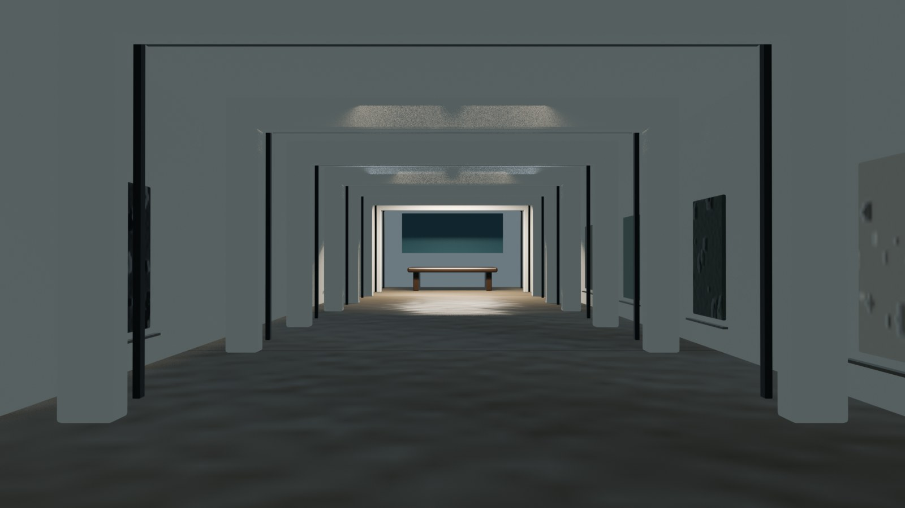

# Luminous Passage 3D pipeline

The production environment is built with **Blender 5.2.x** only. It has no
network access, telemetry, downloaded materials, or third-party add-ons. The
procedural source bakes 15 PBR surface sets into portable PNG maps and embeds
the maps in the delivered GLBs.



## Delivery contract

- Author: **kr8tiv-io**
- Asset license: **CC-BY-4.0**
- Source: `tools/blender/build_luminous_passage.py`
- Blender pin: **5.2.x** (the builder fails on a different major/minor version)
- Browser delivery: six self-contained GLBs, a manifest, poster renders, and
  KTX2-ready PNG source maps in `public/3d/textures/luminous-passage/`.

`luminous-passage-camera.glb` carries the camera animation. The manifest also
contains the renderer-agnostic fallback path; `cameraHandoff.verticalFovDegrees`
is intentionally the vertical FOV used by Three.js, while the 64° horizontal
authoring field is retained for provenance.

## Commands

```sh
npm run build:3d             # requires locally installed Blender 5.2.x
npm run validate:3d:blender  # deep Blender-aware export validation
npm run validate:3d          # pure Node validation of committed browser assets
npm run build                # automatically runs the pure Node validation first
```

Regeneration uses a managed temporary staging directory, validates there, then
uses transactional per-path replacements with an explicit rollback backup (not a
directory-level atomic swap) before validating the committed destination again.
The final check is safe for Hostinger/static production builds: it validates
committed files and never invokes Blender. JSON/geometry/material structure is
deterministic; Blender may vary binary hashes between exporter builds.
